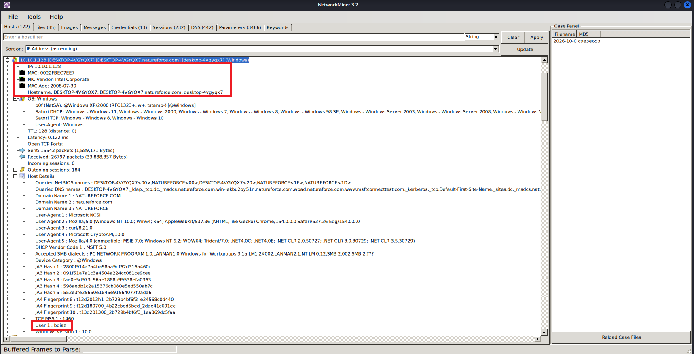
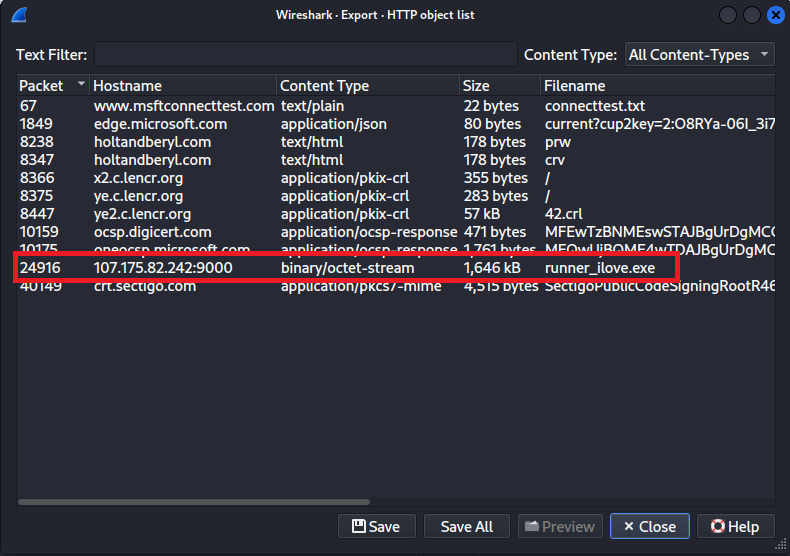
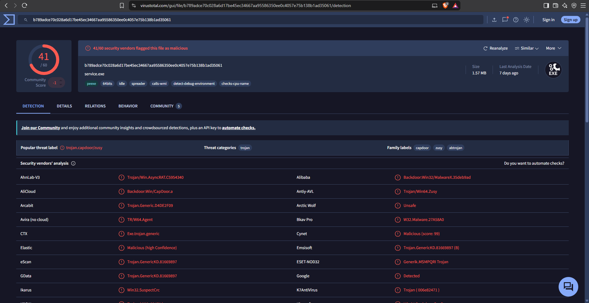
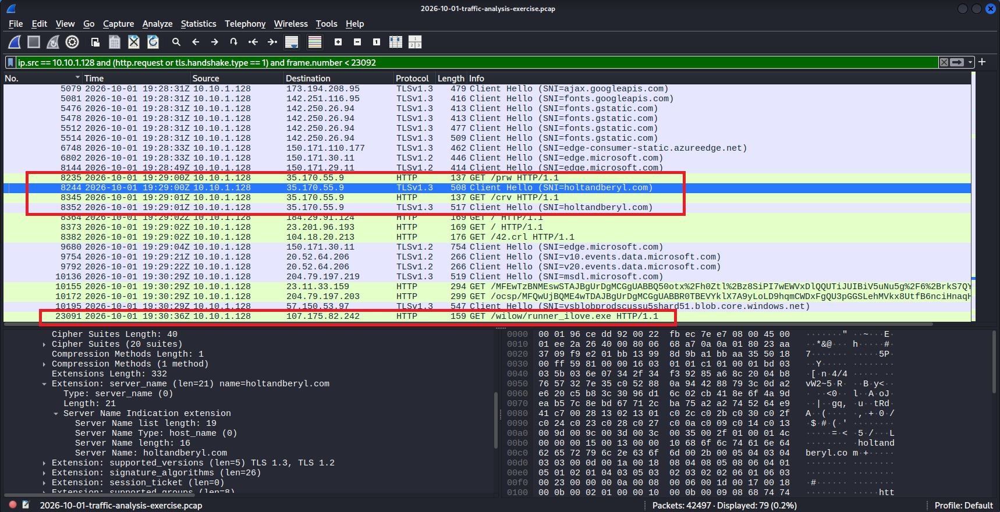
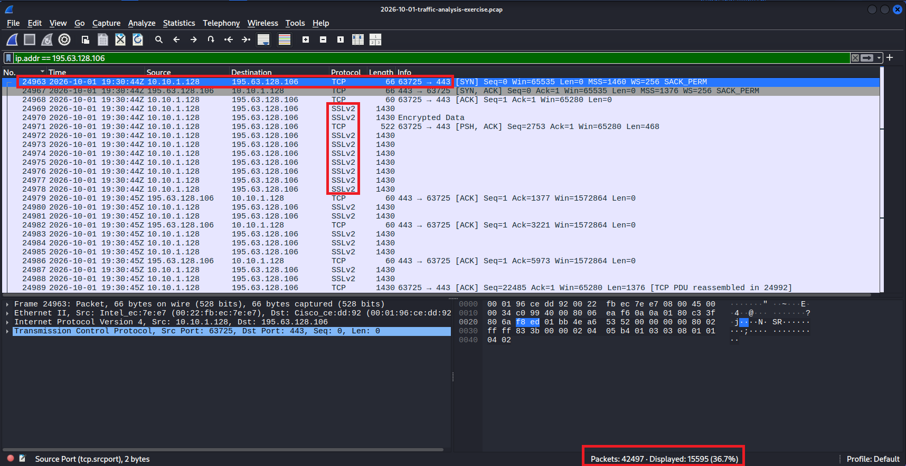

# Incident Report: Case 01 (Natureforce)

## 1. Executive Summary
On October 1, 2026, a Windows workstation (`DESKTOP-4VGYQX7`, IP `10.10.1.128`) logged in under user `bdiaz` was infected with malware after visiting an external website (`holtandberyl[.]com`). About 96 seconds after visiting the site, the host used `curl/8.21.0` to download a 1.57 MB executable (`runner_ilove.exe`) from `107[.]175[.]82[.]242` over TCP port `9000`. Six seconds after the download finished, the workstation opened a persistent, non-standard encrypted C2 connection to `195[.]63[.]128[.]106:443`, which accounted for 15,595 packets (36.7% of the entire capture).

## Evidence Metadata
* **Capture File:** `2026-10-01-traffic-analysis-exercise.pcap`
* **File Size:** `36 MB` (`36,158,156 bytes`)
* **SHA-256:** `287d6dee90cfef71f98a97c42e30444608de2cf59d2f7392a0a6df8dbbc8274b`
* **Total Packets:** `42,497`
* **Capture Duration:** `00:40:31` (`2026-10-01 19:27:27Z` to `20:07:58Z`)
---

## 2. Infected Host Profile

| Field | Value |
| :--- | :--- |
| **Internal IP** | `10.10.1.128` |
| **MAC Address** | `00:22:FB:EC:7E:E7` (Intel Corporate) |
| **Hostname** | `DESKTOP-4VGYQX7` (`DESKTOP-4VGYQX7.natureforce.com`) |
| **AD Domain** | `NATUREFORCE.COM` |
| **Domain Controller** | `10.10.1.10` (`WIN-LEKBU2OY51N.natureforce.com`) |
| **Windows Username** | `bdiaz` |
| **Operating System** | Windows |

 
*Figure 1: Infected host profile (`10.10.1.128`, `DESKTOP-4VGYQX7`) and Kerberos username (`bdiaz`) in NetworkMiner.*

---

## 3. Attack Timeline (UTC)

| Timestamp (UTC)        | Stage                 | Activity                                                                                                                                              | Packet Reference                       |
| :--------------------- | :-------------------- | :---------------------------------------------------------------------------------------------------------------------------------------------------- | :------------------------------------- |
| `2026-10-01 19:29:00Z` | **Initial Access**    | Host `10.10.1.128` sends `GET /prw` to `35[.]170[.]55[.]9`, followed by a TLS connection to `holtandberyl[.]com` (`GET /crv` follows at `19:29:01Z`). | Packets `8235`, `8244`, `8345`, `8352` |
| `2026-10-01 19:30:36Z` | **Payload Delivery**  | Host uses `curl/8.21.0` to request `hxxp://107[.]175[.]82[.]242:9000/wilow/runner_ilove.exe`.                                                         | Packet `23091`                         |
| `2026-10-01 19:30:38Z` | **Download Complete** | Server finishes sending `runner_ilove.exe` (`HTTP/1.1 200 OK`, `1,646 kB`, `binary/octet-stream`).                                                    | Packet `24916`                         |
| `2026-10-01 19:30:44Z` | **C2 Established**    | Six seconds later, `10.10.1.128` connects directly to `195[.]63[.]128[.]106:443` and sends custom encrypted traffic (labeled `SSLv2` by Wireshark).   | Packet `24963` (15,595 total packets)  |

---

## 4. Investigation Findings

### Initial Triage
Checking Wireshark's Protocol Hierarchy and TCP Conversations showed that 85.5% of the traffic volume was encrypted TLS. Two large external downloads stood out at the top of the conversations list (14 MB and 12 MB). Checking TLS Server Name Indication (SNI) values confirmed that `57.150.53.97:443` (12 MB) was legitimate Microsoft Azure Blob Storage (`vsblobprodscussu5shard51.blob.core.windows.net`), so it was ruled out as background noise.

### Payload Extraction and Verification
NetworkMiner v3.2 was used to profile the internal workstation (`10.10.1.128`) and extract the Kerberos username (`bdiaz`). However, NetworkMiner's Files tab did not carve the malicious executable, likely because the transfer happened over non-standard TCP port `9000`. Checking Wireshark's `File -> Export Objects -> HTTP` immediately revealed `runner_ilove.exe` at Packet `24916`.

  

*Figure 2: Wireshark HTTP Object Export showing `runner_ilove.exe` downloaded from `107.175.82.242:9000` at Packet 24916.* 

 
Calculating the SHA-256 hash of `runner_ilove.exe` and checking it on VirusTotal confirmed it as malicious, with 41/60 security vendors flagging it under `trojan.capdoor/zusy` and RAT/backdoor families.

*Figure 3: VirusTotal analysis of `runner_ilove.exe` confirming 41/60 malicious detections.*

### Tracing Initial Access
After finding `runner_ilove.exe` at Packet `24916` via HTTP Object Export, filtering for `http.request.uri contains "runner_ilove.exe"` located the initial `GET` request at Packet `23091` (`19:30:36Z`). To see what triggered the download, outbound HTTP and TLS Client Hello traffic from `10.10.1.128` was filtered up to that point (`frame.number < 23092`), keeping Packet `23091` as the bottom reference row. Aside from standard Microsoft and Google background traffic, the only third-party site visited was `holtandberyl[.]com` (`35[.]170[.]55[.]9`) at `19:29:00Z`, 96 seconds before `curl/8.21.0` downloaded the payload.

*Figure 4: Outbound web activity linking `holtandberyl.com` (`19:29:00Z`) to the `runner_ilove.exe` download (`19:30:36Z`).*

### Command and Control (C2) Traffic
Filtering for the remaining 14 MB external IP (`ip.addr == 195.63.128.106`) showed a persistent session starting at `19:30:44Z`, six seconds after `runner_ilove.exe` finished downloading. There was no DNS lookup for this IP, and the stream lacked a normal TLS Client Hello. Wireshark misclassified the raw encrypted traffic as `SSLv2`, which is consistent with a custom encrypted C2 channel running on port `443` to blend in with HTTPS traffic.

*Figure 5: Post-infection C2 session to `195.63.128.106:443` starting at `19:30:44Z` with non-standard encrypted traffic labeled as `SSLv2`.*

### Post-Infection Scoping
Traffic from `10.10.1.128` after Packet `24916` (`19:30:38Z`) was checked for secondary C2 servers, non-standard outbound ports, and internal lateral movement (`SMB2`, `LDAP`, `DCE/RPC`) across the `10.10.1.0/24` subnet. No other malicious external connections or lateral movement attempts were found during the capture window.

---

## 5. Indicators of Compromise (IOCs)

| Type | Indicator (Defanged) | Role |
| :--- | :--- | :--- |
| **Domain** | `holtandberyl[.]com` | Initial access website |
| **IPv4** | `35[.]170[.]55[.]9` | IP hosting `holtandberyl[.]com` |
| **URL** | `hxxp://107[.]175[.]82[.]242:9000/wilow/runner_ilove.exe` | Stage-1 malware download URL (via `curl/8.21.0`) |
| **IPv4** | `107[.]175[.]82[.]242` | Malware staging server (TCP port `9000`) |
| **SHA-256** | `b789adce70c028a6d17be45ec34667aa95586350ee0c4057e75b138b1ad35061` | `runner_ilove.exe` (1.57 MB Win64 PE, 41/60 VT detections) |
| **IPv4** | `195[.]63[.]128[.]106` | Post-infection C2 server (TCP port `443`) |

---

## 6. Recommended Remediation Actions
1. **Isolate the Host:** Quarantine `DESKTOP-4VGYQX7` (`10.10.1.128`) from the network using EDR or switch port isolation to cut off the C2 connection.
2. **Block IOCs:** Block `holtandberyl[.]com`, `35[.]170[.]55[.]9`, `107[.]175[.]82[.]242`, and `195[.]63[.]128[.]106` on firewalls, proxies, and DNS filters. Restrict unnecessary outbound traffic on non-standard ports like TCP `9000`.
3. **Reset Credentials:** Reset the Active Directory password and revoke active sessions for user `bdiaz`.
4. **Search for Other Affected Hosts:** Check SIEM and proxy logs across `NATUREFORCE.COM` for any other machines that visited `holtandberyl[.]com`, ran `curl` to raw external IPs, or contacted `195[.]63[.]128[.]106`.
