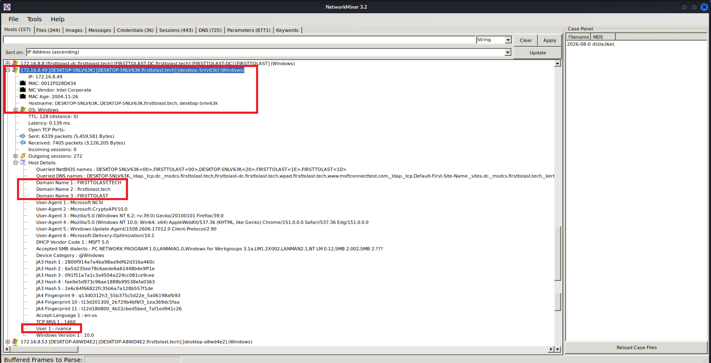
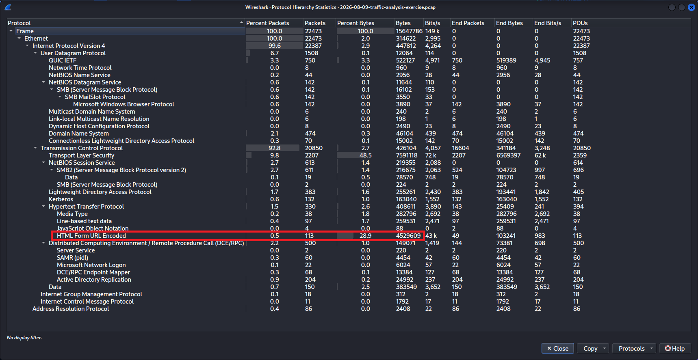
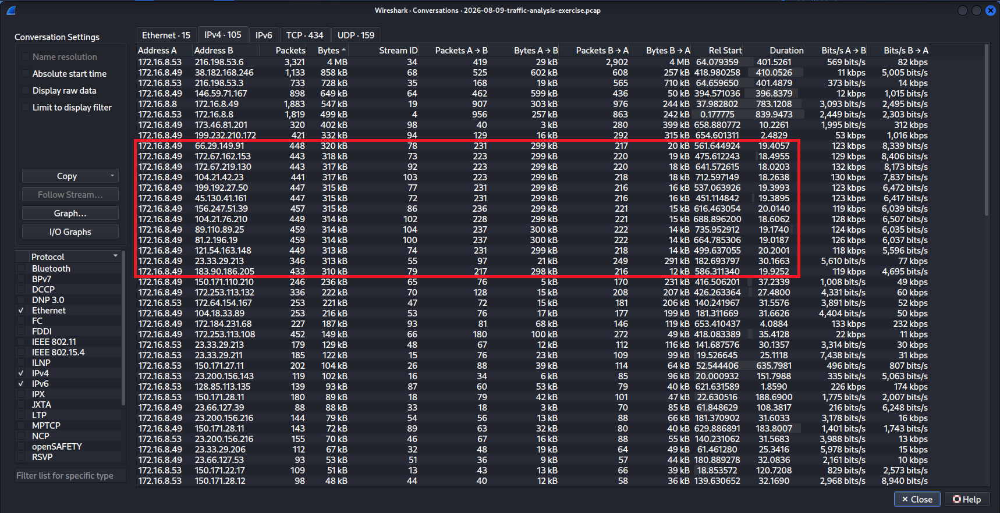
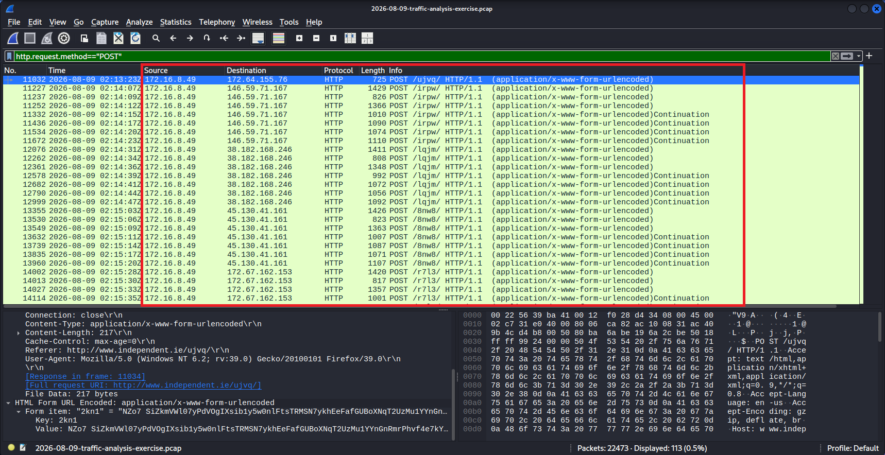
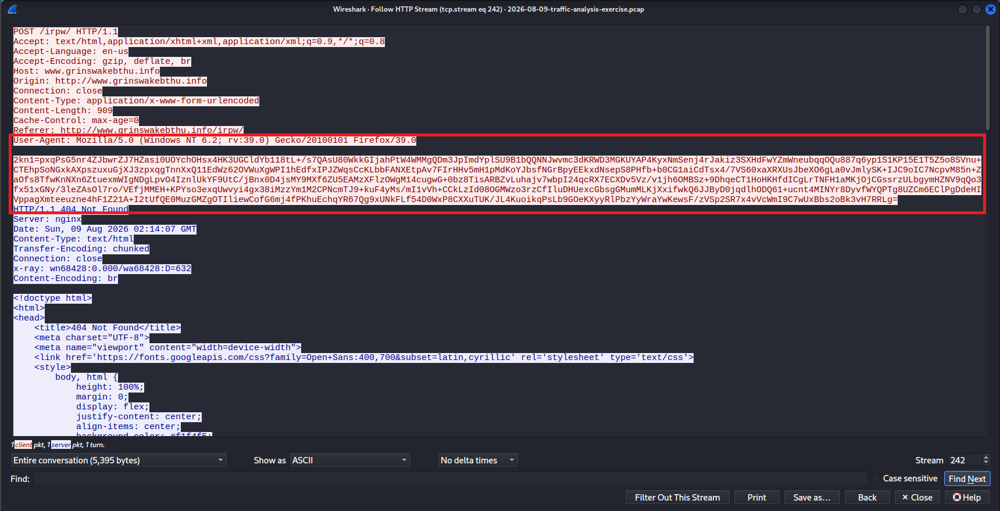

# Incident Report: Case 02 (First to Last)

## 1. Executive Summary
On August 9, 2026, a Windows workstation (`DESKTOP-5NLV63K`, IP `172.16.8.49`) logged in under domain user `rvance` exhibited active infostealer behavior consistent with FormBook/XLoader. Starting at `02:13:23Z`, the host generated 113 unencrypted HTTP `POST` requests totaling 4.53 MB (28.9% of the entire capture) across 15 external IP addresses. Each request used a hardcoded legacy User-Agent (`Firefox/39.0`), targeted random 4-character URI paths (`/ujvq/`, `/irpw/`, `/lqjm/`, `/8nw8/`), and transmitted Base64-encoded payloads inside a `2kn1=` form parameter. All inspected destinations returned `404 Not Found`, `301`, or soft-404 JSON responses, confirming decoy C2 traffic blending. Pre-infection traffic contained only routine Microsoft background activity, indicating initial execution occurred locally outside the capture window. A second internal workstation (`172.16.8.53`) was investigated and confirmed clean.

## Evidence Metadata
* **Capture File:** `2026-08-09-traffic-analysis-exercise.pcap`
* **File Size:** `16 MB` (`15,647,786 bytes`)
* **SHA-256:** `0ea6b597732a9ce6af9a7e3adff4512c9a91b4bce27184c8fdeb746f05cce170`
* **Total Packets:** `22,473`
* **Capture Duration:** `00:14:00` (`2026-08-09 02:07:32Z` to `02:21:32Z`)
---

## 2. Infected Host Profile

| Field                 | Value                                                  |
| :-------------------- | :----------------------------------------------------- |
| **Internal IP**       | `172.16.8.49`                                          |
| **MAC Address**       | `00:12:F0:28:D4:34` (Intel Corporate)                  |
| **Hostname**          | `DESKTOP-5NLV63K` (`DESKTOP-5NLV63K.firsttolast.tech`) |
| **AD Domain**         | `FIRSTTOLAST.TECH`                                     |
| **Domain Controller** | `172.16.8.8` (`FIRSTTOLAST-DC.firsttolast.tech`)       |
| **Windows Username**  | `rvance`                                               |
| **Operating System**  | Windows 10                                             |

*Figure 1: Infected host profile (`172.16.8.49`, `DESKTOP-5NLV63K`), domain (`FIRSTTOLAST.TECH`), and user (`rvance`) in NetworkMiner.*

---

## 3. Attack Timeline (UTC)

| Timestamp (UTC)                      | Stage                             | Activity                                                                                                                                                                                                                                              | Packet Reference                  |
| :----------------------------------- | :-------------------------------- | :---------------------------------------------------------------------------------------------------------------------------------------------------------------------------------------------------------------------------------------------------- | :-------------------------------- |
| `2026-08-09 02:08:13Z` - `02:12:59Z` | **Pre-Infection Baseline**        | Host `172.16.8.49` generates only routine Windows, MSN, Bing, and Office background traffic (`connecttest.txt`, `.cab` updates, and Microsoft TLS sessions).                                                                                          | Packets `1880` - `10880`          |
| `2026-08-09 02:13:23Z`               | **Beaconing Starts**              | Host sends the first malicious `POST /ujvq/` request to `172[.]64[.]155[.]76` (`www[.]independent[.]ie`) using a spoofed `Firefox/39.0` User-Agent and `2kn1=` form payload.                                                                          | Packet `11032`                    |
| `2026-08-09 02:14:07Z`               | **Decoy C2 Burst**                | Host begins rapid `POST /irpw/` bursts to `146[.]59[.]71[.]167` (`www[.]grinswakebthu[.]info`), uploading `599 kB` total while receiving `HTTP/1.1 404 Not Found` replies.                                                                            | Packet `11227`                    |
| `2026-08-09 02:14:31Z` - `02:20:55Z` | **Soft-404 & Continued Spraying** | Host uploads `602 kB` via `POST /lqjm/` to `38[.]182[.]168[.]246` (`www[.]taibeinan[.]cc`), which returns `200 OK` with a soft-404 JSON body. Additional ~300 kB bursts continue across 12 external IPs (`/8nw8/`, `/r713/`, etc.) until capture end. | Packets `12076`, `12289`, `21911` |

---

## 4. Investigation Findings

### Initial Triage
Wireshark's Protocol Hierarchy immediately flagged an unusual volume of unencrypted HTTP form data. `HTML Form URL Encoded` traffic accounted for `4,529,609 bytes` (28.9% of all traffic in the capture) across just 113 packets.

*Figure 2: Wireshark Protocol Hierarchy showing 4.53 MB (28.9%) of unencrypted HTML Form URL Encoded traffic.*

Reviewing IPv4 Conversations sorted by total bytes isolated `172.16.8.49` as the source of the outbound uploads. Unlike normal download-heavy browsing, `172.16.8.49` pushed `602 kB` to `38.182.168.246`, `599 kB` to `146.59.71.167`, and a robotic cluster of identical `298 kB` to `300 kB` uploads across a dozen external IP addresses, each lasting roughly 18 to 20 seconds. Checking `File -> Export Objects -> HTTP` confirmed no executables or scripts were downloaded over plain HTTP during the capture, showing only Windows `.cab` files and extensionless 4-character objects tied to the `POST` traffic.

*Figure 3: IPv4 Conversations showing repetitive 298-300 kB outbound uploads from `172.16.8.49`.*

### Tracing Initial Access
Filtering outbound HTTP and TLS Client Hello requests from `172.16.8.49` prior to the first malicious `POST` (`frame.number < 11033`) and excluding routine Microsoft, Windows, MSN, Bing, and Office domains returned zero third-party web activity. This confirms the malware was not downloaded over HTTP or HTTPS during the capture window and was instead already present on `DESKTOP-5NLV63K` (such as a local file or phishing attachment executed shortly before `02:13:23Z`).

### HTTP POST Flood and Decoy C2 Traffic
Filtering for `http.request.method == "POST"` showed that all 113 `POST` requests originated exclusively from `172.16.8.49`. Beginning at `02:13:23Z` (Packet `11032`), the host fired rapid bursts every 2 to 3 seconds to random 4-character directories (`/ujvq/`, `/irpw/`, `/lqjm/`, `/8nw8/`, `/r713/`) across rotating external IP addresses.

*Figure 4: Filtered HTTP POST requests from `172.16.8.49` hitting random 4-character URI paths every few seconds.*

Following the HTTP stream for Packet `11227` (`POST /irpw/` to `www[.]grinswakebthu[.]info`) revealed the classic FormBook/XLoader network signature:
* **Spoofed User-Agent:** Every malicious request used `Mozilla/5.0 (Windows NT 6.2; rv:39.0) Gecko/20100101 Firefox/39.0`, which conflicted with the workstation's legitimate modern Edge browser (`Edg/151.0.0.0`) observed in NetworkMiner.
* **Encoded Payload:** The request body submitted Base64-encoded encrypted data under a single random form parameter (`2kn1=`).
* **Decoy Blending:** `www[.]grinswakebthu[.]info` rejected the request with `HTTP/1.1 404 Not Found`. Spot-checking the other targeted domains showed the same pattern of rejections (`404 Not Found`, `403 Forbidden`, `301` redirects, and dropped/blank responses), confirming the malware was spraying decoy sites to hide its real C2.

*Figure 5: HTTP stream for Packet 11227 showing the hardcoded `Firefox/39.0` User-Agent, `2kn1=` payload, and `404 Not Found` decoy reply.*

Filtering for successful server responses (`ip.dst == 172.16.8.49 and http.response.code == 200` excluding Microsoft updates) found only one `POST` target returning `200 OK`: `38[.]182[.]168[.]246` (`www[.]taibeinan[.]cc`) at Packets `12289` and `21911`. Inspecting that stream showed a soft-404 JSON body (`{"code":404,"msg":"404 not found","data":{}}`). No active C2 server returned a valid command during the capture, indicating the real C2 panel was either offline or configured to return fake `404` responses after logging exfiltrated data.

### Post-Infection Scoping
Because IPv4 Conversations showed a second internal workstation (`172.16.8.53`, `DESKTOP-A8WD4E2`) downloading 4 MB from `216.198.53.6`, its outbound HTTP and TLS traffic was reviewed separately. All connections to `216.198.53.6`, `216.198.53.3`, and `216.198.54.6` resolved to legitimate Zendesk documentation domains (`docs.useworkshop.com`, `workshop4420.zendesk.com`, and `zdassets.com`), surrounded by routine Microsoft and Bing traffic. `172.16.8.53` generated zero malicious `POST` requests and was ruled out as clean, confirming `172.16.8.49` as the only compromised host.

---

## 5. Indicators of Compromise (IOCs)

### High-Confidence Behavioral IOCs (For Detection)
| Type | Indicator | Role |
| :--- | :--- | :--- |
| **User-Agent** | `Mozilla/5.0 (Windows NT 6.2; rv:39.0) Gecko/20100101 Firefox/39.0` | Hardcoded legacy User-Agent used by FormBook/XLoader |
| **HTTP Pattern** | `POST /[4-char]/` with `2kn1=` form parameter | Infostealer C2 beacon and exfiltration format |

### Observed Decoy / C2-Candidate Targets (Context Only)
*Note: VirusTotal checks confirm most of these IPs are clean or belong to shared CDN infrastructure (such as Cloudflare `104.21.x.x` and `172.67.x.x`). This is expected with FormBook/XLoader decoy spraying, so these IPs should be used for hunting and correlation rather than blanket firewall blocking.*

| Type                      | Indicators (Defanged)                                                                                                                                                                                                                                                                                                                                   | Observed Behavior                                                                                              |
| :------------------------ | :------------------------------------------------------------------------------------------------------------------------------------------------------------------------------------------------------------------------------------------------------------------------------------------------------------------------------------------------------ | :------------------------------------------------------------------------------------------------------------- |
| **IPv4 Cluster (15 IPs)** | `38[.]182[.]168[.]246`, `45[.]130[.]41[.]161`, `66[.]29[.]149[.]91`, `81[.]2[.]196[.]19`, `89[.]110[.]89[.]25`, `104[.]21[.]42[.]23`, `104[.]21[.]76[.]210`, `121[.]54[.]163[.]148`, `146[.]59[.]71[.]167`, `156[.]247[.]51[.]39`, `172[.]64[.]155[.]76`, `172[.]67[.]162[.]153`, `172[.]67[.]219[.]130`, `183[.]90[.]186[.]205`, `199[.]192[.]27[.]50` | All 15 external IPs targeted by the 113 outbound HTTP `POST` requests from `172.16.8.49` (decoy/CDN spray mix) |

---

## 6. Recommended Remediation Actions
1. **Isolate the Host:** Quarantine `DESKTOP-5NLV63K` (`172.16.8.49`) from the network via EDR or switch port isolation to stop ongoing infostealer activity.
2. **Reset Credentials:** Force a password reset and revoke all active tokens and sessions for domain account `rvance`. Because FormBook/XLoader harvests browser-saved credentials and keystrokes, require the user to reset any web or third-party passwords accessed from that workstation.
3. **Investigate Endpoint Artifacts:** Review EDR process trees, email gateways, and local `Downloads` / `Temp` folders on `DESKTOP-5NLV63K` around `02:13:23Z` to identify the initial malicious file and persistence mechanism (such as Run keys or scheduled tasks).
4. **Hunt and Alert Across the Network:** Create SIEM or IDS detection rules for outbound HTTP `POST` requests using the `Firefox/39.0` User-Agent or high-frequency 4-character URI paths, and sweep `FIRSTTOLAST.TECH` logs to confirm no other hosts exhibit the same pattern.

